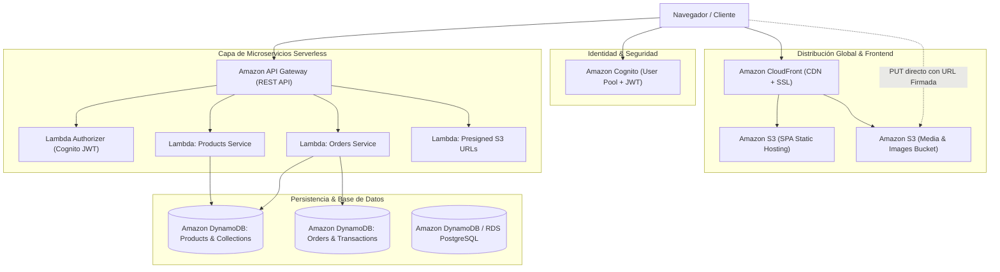

# 🚀 AWS DEPLOYMENT CHECKLIST - "GONE SURFING" E-COMMERCE

Esta guía documenta la arquitectura de nube, los endpoints REST esperados por `src/services/api.ts`, la configuración de variables de entorno y los pasos detallados para migrar y desplegar el e-commerce **Gone Surfing** en **Amazon Web Services (AWS)** con alta disponibilidad, seguridad OWASP y rendimiento global.

---

## 🏛️ 1. Arquitectura Cloud-Ready en AWS



---

## 🌐 2. Variables de Entorno Requeridas (`.env`)

Para cambiar la persistencia de simulación local a AWS, establece en `.env` (o en las variables de entorno de tu pipeline CI/CD en AWS Amplify / GitHub Actions):

```env
# Modo de persistencia: 'aws' para producción, 'local' para desarrollo offline
VITE_STORAGE_MODE=aws

# Región principal de AWS
VITE_AWS_REGION=us-east-1

# URL Base de API Gateway (Stage de Producción)
VITE_AWS_API_GATEWAY_URL=https://api.gonesurfing.pe/prod

# Amazon Cognito (Autenticación JWT de Administrador y Clientes)
VITE_AWS_COGNITO_USER_POOL_ID=us-east-1_xxxxxxxxx
VITE_AWS_COGNITO_CLIENT_ID=xxxxxxxxxxxxxxxxxxxxxxxxxx

# Amazon S3 & CloudFront (Almacenamiento y CDN de imágenes optimizadas)
VITE_AWS_S3_BUCKET=gone-surfing-media-prod
VITE_AWS_CLOUDFRONT_URL=https://media.gonesurfing.pe

# Opcional: Integración para confirmaciones por correo (ej. EmailJS o AWS SES)
VITE_EMAILJS_SERVICE_ID=service_surf
VITE_EMAILJS_TEMPLATE_ID=template_order_conf
VITE_EMAILJS_PUBLIC_KEY=xxxxxxxxxxxxxxxx
```

---

## 📡 3. Especificación de Endpoints REST (`src/services/api.ts`)

La capa de abstracción `src/services/api.ts` está preparada para conectarse a una API REST en **Amazon API Gateway** con los siguientes contratos:

### 3.1. Autenticación (`/auth`)

#### `POST /auth/admin/login`
- **Público / Rate Limited.**
- **Body:**
  ```json
  {
    "user": "surf_admin",
    "password": "StrongPassword123!"
  }
  ```
- **Respuesta Exitosa (200 OK):**
  ```json
  {
    "ok": true,
    "token": "eyJraWQiOiJ...",
    "expiresAt": 1740000000000
  }
  ```

#### `POST /auth/customers/register`
- **Público.**
- **Body:** Objeto `CustomerUser` con datos de contacto, documento (DNI/CE) y contraseña.
- **Respuesta (201 Created):** Retorna el usuario registrado sin el campo de contraseña.

#### `POST /auth/customers/login`
- **Público.**
- **Body:** `{ "email": "surf@ocean.pe", "password": "..." }`
- **Respuesta (200 OK):** Retorna `CustomerUser` autenticado con token de sesión.

---

### 3.2. Productos (`/products`)

#### `GET /products`
- **Público (con caché en CloudFront).**
- **Respuesta (200 OK):** Array de productos:
  ```json
  [
    {
      "id": "p1",
      "name": "Stay Real Tee",
      "price": 109.00,
      "category": "Merch",
      "collectionName": "The slow days",
      "image": "https://media.gonesurfing.pe/products/prod-1.webp",
      "stocks": { "S": 8, "M": 12, "L": 9, "XL": 4 }
    }
  ]
  ```

#### `POST /products`
- **Privado (`Authorization: Bearer <Admin_JWT>`).**
- **Body:** `Omit<Product, "id">` con validación de precio > 0 y stocks por variante.
- **Respuesta (201 Created):** Producto creado con ID asignado.

#### `PUT /products/{id}`
- **Privado (`Authorization: Bearer <Admin_JWT>`).**
- **Body:** Campos actualizados del producto (`name`, `price`, `category`, `collectionName`, `image`, `stocks`).
- **Respuesta (200 OK):** Producto actualizado.

#### `DELETE /products/{id}`
- **Privado (`Authorization: Bearer <Admin_JWT>`).**
- **Respuesta (200 OK):** `{ "success": true }`

---

### 3.3. Colecciones (`/collections`)

#### `GET /collections`
- **Público.** Retorna todas las colecciones activas y archivadas.

#### `POST /collections`
- **Privado (`Authorization: Bearer <Admin_JWT>`).**
- **Body:** `{ "title": "The Blue", "subtitle": "Born to conquer.", "category": "HIGH PERFORMANCE", "image": "..." }`

#### `PATCH /collections/{id}/toggle`
- **Privado (`Authorization: Bearer <Admin_JWT>`).**
- Alterna el estado `active: boolean` de la colección en el carrusel de la tienda.

#### `DELETE /collections/{id}`
- **Privado (`Authorization: Bearer <Admin_JWT>`).**
- Elimina la colección y reasigna los productos huérfanos a `"Catálogo General"`.

---

### 3.4. Pedidos (`/orders`)

#### `GET /orders`
- **Privado (`Authorization: Bearer <Admin_JWT>`).** Retorna todas las transacciones históricas para el dashboard de métricas y gestión de pedidos.

#### `POST /orders`
- **Público / Validado.**
- **Transacción Atómica (DynamoDB `TransactWriteItems`):**
  1. Verifica que haya stock disponible en cada variante solicitada.
  2. Descuenta las unidades del inventario.
  3. Recalcula el Subtotal e IGV del 18% incluido según SUNAT en céntimos enteros.
  4. Guarda el registro de la orden con estado `"Procesando"`.
- **Respuesta (201 Created):** Objeto `OrderTransaction` con número de orden `ORD-XXXX`.

#### `PATCH /orders/{id}/status`
- **Privado (`Authorization: Bearer <Admin_JWT>`).**
- Actualiza estado: `"Procesando" | "Enviado" | "Entregado" | "Cancelado"`.
- **Nota SUNAT / Inventario:** Si el estado cambia a `"Cancelado"`, la Lambda devuelve automáticamente el stock reservado al catálogo.

---

### 3.5. Carga de Multimedia Optimizada (`/media`)

#### `POST /media/presign`
- **Privado (`Authorization: Bearer <Admin_JWT>`).**
- **Body:**
  ```json
  {
    "fileName": "surf-board.webp",
    "contentType": "image/webp",
    "sizeBytes": 45020
  }
  ```
- **Respuesta (200 OK):**
  ```json
  {
    "uploadUrl": "https://gone-surfing-media-prod.s3.amazonaws.com/products/abc-123.webp?AWSAccessKeyId=...",
    "fileKey": "products/abc-123.webp",
    "publicUrl": "https://media.gonesurfing.pe/products/abc-123.webp"
  }
  ```
- El frontend realiza un `fetch(uploadUrl, { method: 'PUT', body: compressedBlob })` directo a S3 sin saturar la memoria de la API Gateway ni de las Lambdas.

---

## 🔒 4. Hardening y Seguridad OWASP en AWS

1. **S3 Bucket Policy & OAC (Origin Access Control):**
   - El bucket S3 que aloja el frontend estático (`dist/`) debe bloquear todo acceso público directo (`Block Public Access: ON`).
   - El acceso se realiza exclusivamente a través de CloudFront mediante OAC.
2. **Soporte SPA Routing en CloudFront:**
   - En la distribución de CloudFront, configurar `Custom Error Responses`:
     - **HTTP Error Code:** `403: Forbidden` y `404: Not Found`
     - **Response Page Path:** `/index.html`
     - **HTTP Response Code:** `200: OK`
   - Esto permite que rutas como `/shop`, `/collections`, `/admin` y `/checkout` funcionen fluidamente al recargar la página.
3. **CORS Seguro en S3 y API Gateway:**
   - Configurar `AllowedOrigins` con el dominio oficial `https://gonesurfing.pe`.
   - Permitir métodos `GET, PUT, POST, DELETE, OPTIONS, PATCH`.
4. **Protección contra Inyecciones y XSS:**
   - Todas las entradas en `Admin.tsx` y `Checkout.tsx` pasan por sanitización y validación estricta (`src/utils/security.ts`).
   - Integridad contable en céntimos enteros previene adulteración de montos o fraude de redondeo.

---

## 🛠️ 5. Pasos de Despliegue con AWS CLI

```bash
# 1. Compilar la aplicación para producción (Sourcemaps deshabilitados, bundle minificado)
pnpm run build

# 2. Sincronizar el directorio dist/ al bucket S3 del frontend
aws s3 sync dist/ s3://gone-surfing-web-frontend/ --delete

# 3. Invalidar la caché de CloudFront para reflejar los cambios al instante
aws cloudfront create-invalidation \
  --distribution-id E1A2B3C4D5E6F7 \
  --paths "/*"
```

